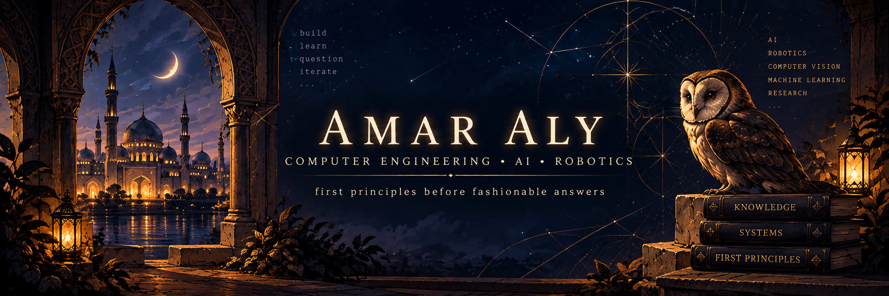

<div align="center">
  
</div>

# Amar Aly

```text
┌───────────────────────────────────────────────────────────┐
│  COMPUTER ENGINEERING • Agentic AI • ROBOTICS             │
│  first principles before fashionable answers              │
└───────────────────────────────────────────────────────────┘
```

Computer Engineering graduate from the **American University of Sharjah**.

I work across **AI systems, computer vision, robotics, and machine learning**, with a habit of diving far deeper into things than originally intended.

> **If something works, I want to know why** so that I don't discover at 3AM that I made an unreasonable assumption for no reason.

---

<table>
  <tr>
    <td width="60%" valign="top">
      <h2>🏛️ Experience</h2>
      <p><strong>🦉 AI Systems</strong><br>
      RAG, AI agents, tool calling, LLM workflows, automation, applied AI systems</p>
      <p><strong>👁️ Computer Vision &amp; Robotics</strong><br>
      Visual SLAM, visual servoing, perception pipelines, resource-constrained deployment</p>
      <p><strong>🧠 Machine Learning</strong><br>
      Deep learning, medical image segmentation, CNNs, Transformers, few-shot learning, reinforcement learning</p>
      <p><strong>📐 Research &amp; Evaluation</strong><br>
      Benchmarking, statistical evaluation, reproducibility, failure analysis</p>
    </td>
    <td width="40%" valign="top">
      <h2>🧭 Engineering philosophy</h2>
      <p>First principles → understand the mechanism → build from there.</p>
      <h2>📚 Teaching</h2>
      <p>I enjoy tutoring, explaining technical ideas, and building educational tools. Teaching is also one of my favorite debugging tools for understanding.</p>
      <blockquote>
        <em>“What I cannot create I do not understand.”</em><br>
        — Richard Feynman
      </blockquote>
    </td>
  </tr>
</table>

## 🛠️ Skills

<p>
  
  
  
  
  
  
  
  
</p>
